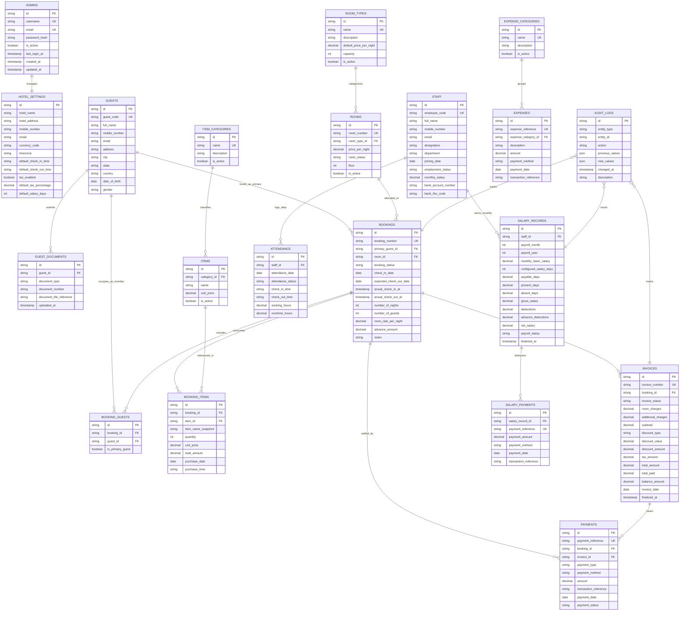

# Hotel Management Software – Complete Database Entity-Relationship Diagram

This document illustrates the entire normalized PostgreSQL schema for the Hotel Management Software. All core transactional entities, financial pipelines, staffing modules, and administrative logs are represented with their exact cardinality.

---

## Complete Mermaid ER Diagram

---

## Visual Subsystem Architecture

1. **Guest & Stay Core**:
   `guests` <-> `guest_documents`  
   `guests` <-> `bookings` <-> `rooms` <-> `room_types`  
   `bookings` <-> `booking_guests` <-> `guests`

2. **Commerce & Billing Pipeline**:
   `item_categories` <-> `items` <-> `booking_items` <-> `bookings`  
   `bookings` <-> `invoices` <-> `payments`  
   `bookings` <-> `payments` (Advance payments recorded before invoice finalization)

3. **Workforce & Payroll Pipeline**:
   `staff` <-> `attendance` (Daily time tracking)  
   `staff` <-> `salary_records` <-> `salary_payments` (Monthly payroll cycles and disbursement)

4. **Cash Flow & Operational Outflows**:
   `expense_categories` <-> `expenses`  
   `daily_cash_book`: Virtual aggregation of `payments` (inflows) and `expenses` + `salary_payments` (outflows).
